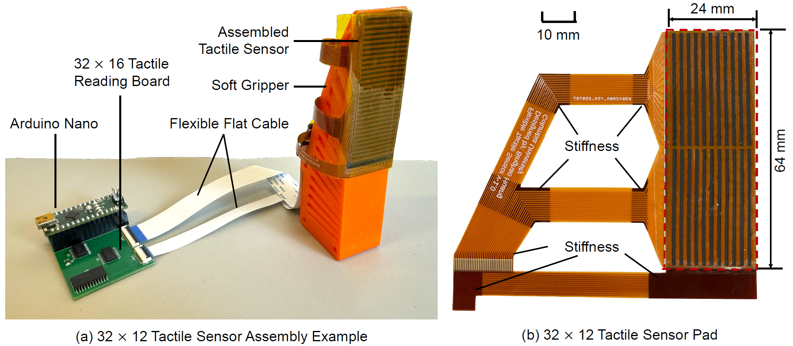

# FlexiTac: An Open-Source, Scalable Tactile Solution for Robotic Systems

**Authors:**  
Binghao Huang¹, Yunzhu Li¹  
¹Columbia University

FlexiTac is an open-source, scalable tactile sensing platform designed to make touch sensing more accessible for robotics. It supports flexible sensor fabrication, real-time tactile readout, and integration into manipulation systems such as grippers, robot arms, and tactile skins. The broader FlexiTac project also includes hardware tutorials, simulation support, and system design examples for robotic applications. 
Project website: https://flexitac.github.io/




## Overview - FlexiTac Mini

This branch features a miniature hardware design for reading FlexiTac tactile sensors with corresponding firmware and python script.


Main improvements: 

- **Smaller footprint, easy to install**: 27.5mm(L)*22mm(W), with two M2 screw mounting holes (23mm horizontal distance).
- **Stronger performance**: featuring an Arm Cortex-M4 MCU (AT32F415KBU7-4) with 150MHz clock and 12-bit resolution ADC (original Arduino Nano is 16MHz and 10-bit), achieving 60 FPS+ tactile upload (70 FPS in testing).
- **Chain connection**: with two UART interface operating at 1Mbps, the MCU sends local tactile data to both UART Tx port, while receiving bytes from both UART Rx port and concat the receive buffer with USB Tx buffer. This topology enables daisy-chain connection between multiple FlexiTac sensors, and the Host PC can read the entire bus from any node's USB port.
- **Timestamp synchronization**: during embodied AI dataset collection, it is of very significance to time-align different types of data from varies of sensors. In the modified packet header, we presented a `uint32_t timestamp` variable, which contains the milliseconds that have elapsed since the node reset. Although we cannot sync the time between nodes (and it's unnecessary), this variable provides important information for the Host PC to carefully align the relative data time.
- **Backward compatibility**: the special design of data packet provides backward compatibility with old `fast_32_16.py`, while new script can also read tactile buffer from original Arduino parts.

To build the tactile sensors, follow the instructions below:
[[Hardware Assembly Tutorial]](https://docs.google.com/document/d/1bvz6AL7BUkhj4Dj7n9DFXTjnGIX4-ziN8-smiCKpVZU/edit?usp=sharing)

## Hardware Description

A FlexiTac sensor is scanned row-by-row and column-by-column by the microcontroller, then streamed to the host computer over serial.

To be compatible with the original protocol, we made a wrapper to the frame (see flexitac_packet.h):

- tactile resolution: **16 × 32**
- serial baud rate (USB CDC): **2,000,000 (or higher)**
- frame format: **2-byte extended header + 2-byte UUID + 4-byte timestamp + 2-byte payload size + (2-byte header + 512 data bytes) + 2-byte crc16**
- frame header (payload, or original): `0xAA 0x55`, frame header (extended): `0x54 0xAA`
- data type: **8-bit unsigned values**

The provided Python script `fast_32_16_multi.py` initializes a baseline from the first few frames, subtracts the baseline, applies thresholding and normalization, and displays _multiple_ node's tactile response as separated heatmaps.

## Option 1 (Quick Start) 

**Note**: You need to know that the official [`flexitac`](https://pypi.org/project/flexitac/) package currently only supports one sensor per USB port. To integrate new features into your own project, you will have to modify the provided `fast_32_16_multi.py` (maybe as a module), and this could be done very efficiently by asking some code agents.

`fast_32_16_multi.py` can be used to debug your device, or provide a basic tactile representation.


### 1. Flash MCU firmware with debugger

The firmware binary `FlexiTac_16x32.bin` is provided under /Firmware/. You should choose a working debugger for ArteryTek AT32 series microcontroller. Typically, any CMSIS-DAP compatible debugger is accepted by the chip with OpenOCD.

**Note**: The OpenOCD version used by Artery is a special version, which could be downloaded on their official [github](https://github.com/ArteryTek/openocd).

The openocd.cfg is provided as follows, or you can find it under firmware folder:

```
# Programmer, can be changed to several interfaces
source [find interface/cmsis-dap.cfg]
# The target MCU. This should match your board
source [find target/at32f415xx.cfg]
```

After uploading, the board should appear as a serial device such as:

```bash
/dev/ttyUSB0
```

### 2. Install

```bash
pip install "flexitac[examples]"
```

The `[examples]` extra pulls in `matplotlib` for the live heatmap.

### 3. Stream / visualize

```bash
sudo chmod 777 /dev/ttyUSB*
flexitac-heatmap --port /dev/ttyUSB0      # live heatmap
flexitac-stream  --port /dev/ttyUSB0      # raw stream + FPS/stats
```

### 4. Use from Python

```python
from flexitac import FlexiTacSensor

with FlexiTacSensor("/dev/ttyUSB0") as sensor:
    for frame in sensor:
        print(frame.normalized.shape, frame.normalized.max())
```

Source and issue tracker for the Python package: https://github.com/WT-MM/PyFlexiTac

---

## Option 2 (Development Installation)

Use this path if you want to modify the firmware, hack on the visualization script, or develop against the raw hardware protocol. This is the source that the PyPI package wraps.

### 1. Flash MCU firmware with debugger

The firmware binary `FlexiTac_16x32.bin` is provided under /Firmware/. You should choose a working debugger for ArteryTek AT32 series microcontroller. Typically, any CMSIS-DAP compatible debugger is accepted by the chip with OpenOCD.

**Note**: The OpenOCD version used by Artery is a special version, which could be downloaded on their official [github](https://github.com/ArteryTek/openocd).

The openocd.cfg is provided as follows, or you can find it under firmware folder:

```
# Programmer, can be changed to several interfaces
source [find interface/cmsis-dap.cfg]
# The target MCU. This should match your board
source [find target/at32f415xx.cfg]
```

After uploading, the board should appear as a serial device such as:

```bash
/dev/ttyUSB0
```


### 2. Install Python dependencies

Install the required Python packages:

```bash
pip install numpy pyserial opencv-python scipy
```

### 3. Check the serial port

Verify the device path on your machine:

```bash
ls /dev/ttyUSB*
```


If needed, update the port in the Python script:

```python
PORT = "/dev/ttyUSB0"
```

### 4. Linux serial permission if needed

If you do not have permission to access the serial device, run:

```bash
sudo chmod 777 /dev/ttyUSB*
```

### 5. Run the example

Start the Python visualizer with:

```bash
python3 fast_32_16.py
```

## 🏷️ License
FlexiTac © 2026 by Columbia University is licensed under CC BY-NC 4.0. To view a copy of this license, visit https://creativecommons.org/licenses/by-nc/4.0/


##  Acknowledgment
We thank Yiyue Luo, Devin Murphy, Michael Foshey, Xinyue Zhu, Yunxi Zhu, Naian Tao, Wesley Maa, Jimmy Wang, Binglin Wang, Irving Fang, Hongyu Li, Yixuan Wang, Hanxiao Jiang, Kaifeng Zhang, Changyi Lin, Xuhui Kang, Yuhao Zhou, Pokuang Zhou, Siyu Ma, Chang Yu, Yuqi Liang, Haonan Chen, Rao Fu, Jinzhou Li, Yuming Gu, Fan Cheng, Xinyi Yang, Mingtong Zhang, Baoyu Li, Toru Lin, Haozhi Qi, Iretiayo Akinola
, Jie Xu, and Yu-Wei Chao for their valuable discussions and support.